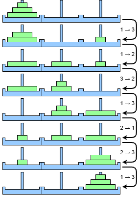
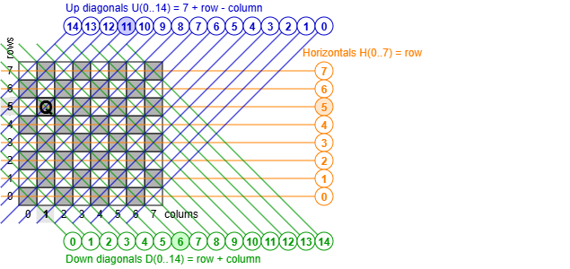
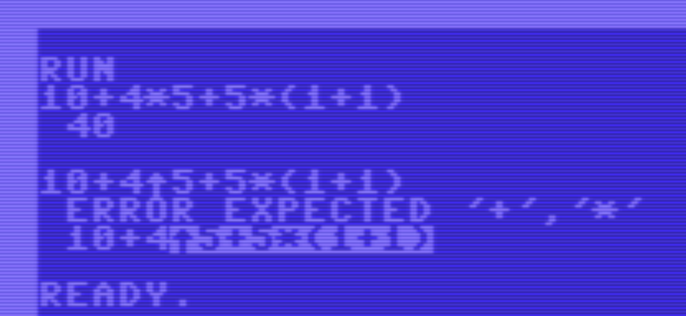

[](https://github.com/maarten-pennings/C64howto/tree/main/MCC#overview)

Maarten Pennings MCC#05


# Recursie in BASIC

Kunnen we recursie gebruiken in Commodore 64 BASIC?
Het korte antwoord is ja, maar het is wat lastiger dan in moderne talen.

## Introductie

Mijn eerst programma's schreef ik in BASIC. Ik kende de officiële termen nog 
niet, maar ik leerde natuurlijk het _assignment statement_ (`LET`) dat de 
volgorde van _operaties in expressies_ kende (`*` voor `+`) en het resultaat 
toekent aan een _variabele_. Die kun je ook `PRINT`en of `INPUT`en.

Er was een hoog niveau `FOR`-`NEXT` statement, maar ook een `IF`. Die is iets 
lager in de pikorde want de `THEN` moet op één regel en een `ELSE` is er niet.
Beide tekortkomingen kun je oplossen met `GOTO`, maar die staat op het 
laagste niveau van programmeer abstracties.

Ten slotte was er nog de magische `GOSUB`, the `GOTO` die onthoudt waarheen 
de `RETURN` terug moet springen. Gemaakt voor _subroutines_.

Ik had geen idee dat subroutines een naam kunnen hebben (_function_), of dat ze
argumenten of lokale variabelen kunnen hebben (op de _stack_). Laat staan 
dat ik enig benul had van zoiets als recursie.

Veel later, hoorde ik van recursie. Terugkijkend vroeg ik mij af of recursie 
mogelijk is op de Commodore 64 (of in andere BASIC dialecten). Het gebrek aan 
een _stack_ en argumenten lijkt roet in het eten te gooien.

In dit artikel bekijken we eerst drie "_mini problemen_" die we met recursie 
oplossen. Geen van de mini problemen zou je in de echte wereld met recursie 
oplossen, maar ze zijn bekend en eenvoudig en zo leren we de valkuilen 
en oplossingen bij recursie in BASIC. Als we die eenmaal kennen dan pakken we 
wat serieuzere "_toepassingen_" aan. 


## Mini probleem 1: Machten van 2

Om 2 tot de macht `N` uit te rekenen kun je in Commodore BASIC 
gewoon `2↑N` typen. Maar wij gaan een recursieve subroutine schrijven 
die dit uitrekent.

In BASIC zijn er geen functies met argumenten of een _return_ waarde.
We gaan voor beide globale variabelen gebruiken. Onze subroutine heeft 
als input `N`. De aanroeper moet `N` een waarde geven voor de `GOSUB` 
naar de subroutine. De subroutine zal 2 tot de macht `N` met recursie 
berekenen en het antwoord toekennen aan de globale variabele `R` ("resultaat").
Na de `RETURN` moet de aanroeper `R` inspecteren.

De vorige paragraaf beschrijft de _signatuur_ van de subroutine:
welke waardes erin gaan (en in welke variabelen) en welke waardes eruit gaan 
(en in welke variabelen). Eén ding ontbreekt nog: welke (globale) variabelen 
worden door de subroutine gebruikt als "kladblok". Ze worden overschreven 
door de subroutine maar krijgen geen bekende of betekenisvolle waarde.
Dit is een belangrijk aspect van een subroutine omdat alle variabelen globaal 
zijn. Als de aanroeper van een subroutine een variabele in gebruik heeft die 
door de subroutine als kladblok wordt gebruikt, dan ontstaan er problemen.

In onze subroutine wordt `N` gewijzigd - een kladblok.
De volledige signatuur van de te ontwikkelen subroutine 
staat op regel 200 (met `MODS:N`).

```BASIC
100 PRINT "POW2"
110 I=0
120 :N=I:GOSUB 200:PRINT "2↑";I;"=";R
130 :I=I+1
140 GOTO 120
150 :
200 REM INP:N; OUT:R=2↑N; MODS:N
210 IF N=0 THEN R=1:RETURN
220 N=N-1
230 GOSUB 200
240 R=R*2
250 RETURN
```

De subroutine staat op 200-250.
Regel 210 implementeert de zogeheten _basis_ van de recursie: `N=0`.
Regels 220 tot 240 bevatten de _stap_ van de recursie:

```
pow2(0)= 1
pow2(n)= pow2(n-1)*2, if n>0
```

Dat is alles. Dat viel best mee. 
We zouden een `FOR`-`NEXT` hebben kunnen gebruiken op regels 110-140,
maar we willen zien hoe die de recursie kan.
Het blijkt dat dit programma de machten van 2 print tot `2↑23`, 
daarna krijgen we een `OUT OF MEMORY ERROR` om dat er een _stack overflow_
plaatsvindt.


## Mini probleem 2: Faculteit

Dit probleem lijkt bedrieglijk veel op het vorige, maar is toch net een 
stapje anders. We gaan `N!` recursief uitrekenen. Voor de volledigheid

```
fac(0)= 1
fac(n)= fac(n-1)*n, if n>0
```

dus 4! = 4×3×2×1 = 24.

Onze subroutine voor faculteit heeft als input `N`. 
De subroutine zal `N!` met recursie berekenen en het antwoord 
toekennen aan de globale variabele `R`.
Laten we aannemen dat net als in het vorige probleem `N` 
een "kladblok" is. En laten we dan ook de subroutine structuur hergebruiken.

```BASIC 
200 REM INP:N; OUT:R=N!; MODS:N
210 IF N=0 THEN R=1:RETURN
220 N=N-1
230 GOSUB 200
240 R=R*N
250 RETURN
```

Dit werkt _niet_. Het probleem zit in regel 240.
Na de `GOSUB 200` is globale variabele `N` gewijzigd,
dus de toekenning `240 R=R*N` is incorrect.

We moeten de signatuur van de subroutine wijzigen: `N` is niet langer een 
kladblok, maar hij behoudt zijn waarde. Dat is de nieuwe specificatie,
zie regel 200 (`KEEP:N`). 

```BASIC 
100 PRINT "FAC"
110 N=0
120 :GOSUB 200
130 :PRINT N;CHR$(157);"! =";R
140 :N=N+1
150 GOTO 120
160 :
200 REM INP:N; OUT:R=N!; KEEP:N
210 IF N=0 THEN R=1:RETURN
220 N=N-1
230 GOSUB 200
240 N=N+1:REM RESTORE N
250 R=R*N
260 RETURN
```

De strengere eis voor `N` is gelukkig makkelijk te realiseren.
Voor de basis `N=0` (regel 210) is er geen toekenning aan `N`, 
dus is er geen wijziging nodig.
Voor de stap als `N>0`, is er wel een toekenning aan `N`, namelijk 
op regel 220: `N=N-1`. De reparatie is op regel 240, waar `N` hersteld
wordt met `N=N+1`. Deze wijziging zorgt ervoor dat ook de stap aan
de nieuwe signatuur voldoet.
En dan is regel `250 R=R*N` wel correct.

Dit programma print een tabel met faculteiten tot `23!`.
Ook hier krijgen we `OUT OF MEMORY ERROR` vanwege een _stack overflow_.


## Mini probleem 3: Fibonacci

Bij `FAC(N)` zagen we dat het nodig is oude waardes te herstellen.
Dat kon daar eenvoudig (met `N=N+1`), maar bij het probleem in deze 
sectie lukt dat niet.

Fibonacci was een wiskundige die een beroemde rij getallen introduceerde: 
0, 1, 1, 2, 3, 5, 8, ..., elke getal is de som zijn twee directe voorgangers.
Iets formeler als volgt te formuleren.

```
fib(0)= 0
fib(1)= 1
fib(n)= fib(n-1) + fib(n-2), if n>1
```

Dat lijkt ook weer op de vorige problemen, dus herhalen we de aanpak.

Onze subroutine heeft als input `N`.
Hij berekent (recursief) `FIB(N)` en kent dat toe aan `R`.
We zullen er voor zorgen dat de waarde van `N` behouden blijft.
De subroutine heeft twee kladblok variabelen `R0` and `R1`.

```basic 
200 REM INP:N; OUT:R=FIB(N); KEEP:N; MODS:R0,R1
210 IF N<2 THEN R=N:RETURN
220 N=N-1:GOSUB 200:R0=R
240 N=N-1:GOSUB 200:R1=R
250 R=R0+R1
260 N=N+2:REM RESTORE N
270 RETURN
```

Deze poging is mislukt. Het was makkelijk om de waarde van `N` te behouden, 
maar zowel `R0` als `R1` staat op de kladblok lijst. De `GOSUB 200` op regel 
240 wijzigt dus `R0` en dus is regel 250 `R=R0+R1` incorrect. Er is geen 
probleem met `R1`, dat is snel te zien.

```basic
220 N=N-1:GOSUB 200:R0=R
240 N=N-1:GOSUB 200:R=R0+R
```

We moeten `R0` herstellen na de tweede `GOSUB 200`. Hoe doen we dat?
`R0` wordt vers berekend, dus een herstel is niet zo eenvoudig als een 
ophoging met 1.

De oplossing is om zelf een stack te maken.
We introduceren een array`S()` met _stackpointer_ `S`.
Merk op dat arrays (zoals `S()`) en getallen (zoals `S`) dezelfde naam 
mogen hebben in BASIC (net als getal `A` en string `A$`). De stack 
wordt aangemaakt op regel 110.

```basic
100 PRINT "FIB"
110 DIM S(30):S=0:REM SETUP STACK
120 N=0
130 :T0=TI:GOSUB 200:T1=TI:T=(T1-T0)/60
140 :PRINT "FIB(";N;")=";R
170 :N=N+1
180 GOTO 130
190 :
200 REM INP:N; OUT:R=FIB(N); KEEP:N,S
210 IF N<2 THEN R=N:RETURN
220 N=N-1:GOSUB 200
230 S(S)=R:S=S+1:REM PUSH R
240 N=N-1:GOSUB 200
250 S=S-1:R=R+S(S):REM POP R
260 N=N+2:REM RESTORE N
270 RETURN
```

- Regel 210 berekent beide basis gevallen (`N=0` and `N=1`); 
  de basis gevallen veranderen `N` en `S` niet.
  
- Regel 220 berekent `FIB(N-1)` en het resultaat `R` wordt _gepushed_ op de stack (regel 230).

- Regel 240 berekent `FIB(N-2)` en het resultaat `R` wordt verhoogd met de waarde die _gepopped_ wordt van de stack (regel 250).
  Deze regel hersteld ook de stackpointer `S`.
  
- Regel 260 herstelt  `N` en beëindigt de subroutine.

We hebben eenzelfde hoofdprogramma als eerst, behalve dat we nu tijdmetingen doen.
Ook dit programma stopt bij 23 met een `OUT OF MEMORY ERROR`.
Het stopt overigens na 1128 secondes ofwel 20 minuten.
Een recursieve subroutine is een erg slechte aanpak voor Fibonacci.


## Mini problemen: Conclusies

Er is in BASIC een stack, maar voor subroutines onthoudt die alleen maar 
waarheen terug gesprongen moet worden. Er staan geen argumenten of lokale 
variabelen op. Er zijn alleen maar globale variabelen in BASIC. Voor 
succesvolle recursie moeten we de waardes in globale variabelen beheren: 
hetzij herstellen zoals we bij de faculteit routine zagen, hetzij in een array 
bewaren zoals we bij de fibonacci routine zagen.

Een `GOSUB` _stack frame_ is beslaat 7 bytes, de C64 BASIC stack is een kleine 
200 bytes groot, en BASIC eist ten alle tijden een ~32 byte marge op de stack
(bijvoorbeeld voor interrupts). Dan is er ruimte voor 22 GOSUB frames.
Dat zagen we in alle mini problemen. Wat is ook nog goed om te weten:
een `FOR`-`NEXT` plaatst een 18 byte stack frame.


## Toepassing 1: Torens van Hanoi

"Torens van Hanoi" is een beroemde puzzel. Er zijn drie pinnen.
Op elke pin liggen schijven. Alle schijven hebben een andere 
diameter. Het spel start met een stapel `N` schijven op pin 1. 
Het is de bedoeling the hele stapel naar pin 3 te verhuizen, 
daarbij deze regels volgend.

- Er mag maar 1 schijf per keer verplaatst worden.
- Alleen de bovenste schijf van een pin mag verplaatst worden.
- Een schijf mag alleen verplaatst worden naar een lege pin, óf 
  bovenop een bestaande stapel gelegd worden, mits de nieuwe schijf
  een kleinere diameter heeft dan de top van de bestaande stapel.

In het plaatje zien we dat er 7 beurten nodig zijn om de stapel
van pin 1 naar pin 3 te verhuizen. De dikke gebogen pijlen 
zijn gelabeld met de verplaatsing: _f→t_ betekent dat de schijf 
van pin _f_ naar pin _t_ verplaatst wordt.



Deze puzzel is eenvoudig op te lossen met recursie. We ontwikkelen een subroutine die de stappen afdrukt om een stapel van `N` schijven te verplaatsen van pin `F` (_from_ pin) naar pin `T` (_to_ pin). Merk op dat er een derde pin is, de _reserve_ pin.

- Als `N` gelijk is aan 0, is de subroutine klaar zonder 
  enige stap te hoeven maken.
- Als `N` groter is dan 0, splitsen we het werk in drie fasen:
  - Vraag recursief om een stapel van `N-1` schijven te verplaatsen
    van `F` naar de _reserve_ pin.
  - Verplaats de `N`-de (onderste) schijf van `F` naar `T`.
  - Vraag recursief om een stapel van `N-1` schijven te verplaatsen 
    van de _reserve_ pin naar `T`.

We zetten dit om naar een BASIC-subroutine. We zorgen ervoor dat 
de waarden van de variabelen `N`, `F` en `T` behouden blijven tijdens 
een subroutine-aanroep. Er is één klein trucje: om de index van 
de _reserve_ pin te berekenen, gebruiken we de expressie `6-T-F`. 
Merk op dat een toewijzing zoals `T=6-T-F` de _to_-pin en de _reserve_-pin omwisselt, en een volgende `T=6-T-F` wisselt ze weer terug.

Dit is het hele programma.

```basic 
100 PRINT "HANOI"
110 F=1:T=3:N=3:GOSUB 200
120 END
130 :
200 REM INP :F=1,2,3 T=1,2,3 T<>F N>=0
210 REM OUT :PRINTED STEPS TO MOVE N
220 REM      DISKS FROM PIN F TO PIN T
230 REM KEEP:F,T,N
240 IF N=0 THEN RETURN
250 T=6-F-T:N=N-1:GOSUB 200
260 T=6-F-T:PRINT F;">";T
270 F=6-F-T:GOSUB 200
280 F=6-F-T:N=N+1:RETURN
```

En dit is de uitvoer.

```
hanoi
 1 > 3
 1 > 2
 3 > 2
 1 > 3
 2 > 1
 2 > 3
 1 > 3
```


## Toepassing 2: 8 Koninginnen 

Het 8 koninginnen probleem is ook een klassieker.
Het doel is om 8 koninginnen op een schaakbord te plaatsen 
zo dat geen koningin een andere aanvalt.

Dit soort problemen wordt vaak opgelost met behulp van 
_recursieve backtracking_. We gaan dit in BASIC doen.

We kunnen het probleem herformuleren: elke rij, elke kolom en 
elke (stijgende of dalende) diagonaal heeft elk maximaal één koningin.

We ontwikkelen een subroutine die als invoer een gedeeltelijk gevuld 
bord `B()` heeft: de eerste `C` kolommen bevatten een koningin (voor 
elke _kolom_ `X`, met `X<C`, is `B(X)` de _rij_ waar de koningin staat).
De subroutine zal het gedeeltelijke bord afvullen (een koningin in 
plaatsen in alle resterenede kolomen) in alle mogelijke manieren, en 
die manieren printen waarbij geen koningin een andere aanvalt.

Om snel te kunnen beslissen waar we een koningin kunnen plaatsen in 
kolom `C` houden we drie arrays bij: `U()` voor de "stijgende diagonalen" 
(up), `D()` voor de "dalende diagonalen", en `H()` voor de 
"horizontale rijen". Het is niet nodig om een array bij te houden voor de 
"verticale kolommen", omdat er door de structuur van de subroutine 
precies één koningin per kolom (per verticale lijn) staat.

Voor de stijgende diagonaal met index `I`, is `U(I)` 0, dan en 
slechts dan als stijgende diagonaal `I` vrij is; er staat geen 
koningin (op het gedeeltelijk gevulde bord) op die diagonaal. 
Hetzelfde geldt voor `D()` en `H()`.

De positie van een koningin is eenvoudig om te zetten in de indexen 
van de stijgende diagonaal en de dalende diagonaal. 
De index van de dalende diagonaal is de _som_ van de rij en de 
kolom, en de index van de stijgende diagonaal is het _verschil_ 
tussen de rij en de kolom (met een offset van 7 om positief te blijven). 
De diagram geeft een voorbeeld: een koningin is geplaatst in kolom 1 
en rij 5. Daarmee valt ze de stijgende (blauwe) diagonaal 11 aan, 
de dalende (groene) diagonaal 6, en de horizontale (oranje) rij 5.



```BASIC 
10 PRINT "8 QUEENS"
12 DIM B(7),H(7),U(14),D(14)
14 T0=TI:C=0:GOSUB 28:T1=TI
16 PRINT (T1-T0)/60:END
18 :
20 REM INP :0<=C<=8 B(0..C-1)
22 REM OUT :PRINTED COMPLETIONS OF B
24 REM      WHERE NO QUEEN ATTACKS OTHER
26 REM KEEP:C,B,H,U,D
28 IF C=8 THEN GOSUB 50:RETURN
30 B(C)=0
32 :IF H(B(C)) THEN 44
34 :IF D(B(C)+C) THEN 44
36 :IF U(7+B(C)-C) THEN 44
38 :H(B(C))=1:D(B(C)+C)=1:U(7+B(C)-C)=1
40 :C=C+1:GOSUB 28:C=C-1
42 :H(B(C))=0:D(B(C)+C)=0:U(7+B(C)-C)=0
44 B(C)=B(C)+1:IF B(C)<8 THEN 32
46 RETURN
48 :
50 FOR X=0 TO 7:PRINT B(X);:NEXT
52 N=N+1:PRINT "#";N:RETURN
```

- Het programma maakt de arrays aan voor het bord (`B()`), 
  de horizontale rijen (`H()`), 
  de stijgende diagonalen (`U()`) en 
  de dalende diagonalen (`D()`) op regel 12.

- De initiële recursieve aanroep staat op regel 14.
  Argument `C` is 0, wat betekent dat het gedeeltelijke bord 
  `B()` helemaal leeg is (0 kolommen gevuld).
  `T0` en `T1` leggen de start- en eindtijd van de subroutine-aanroep vast.
  Regel 16 drukt de totale uitvoeringstijd in seconden af.

- De recursieve backtracking-subroutine bevindt zich op regels 20-46.
  Wanneer het bord compleet is (wanneer `C` gelijk is aan 8) hebben we 
  een oplossing gevonden. De subroutine op regel 50 wordt aangeroepen, 
  die de oplossing afdrukt (waarbij het oplossingsnummer `N` wordt verhoogd).

- Als het bord nog niet compleet is (`C<8`) probeert de subroutine een 
  koningin in kolom `C` te plaatsen.
  Het doorloopt alle rijen van 0 (regel 30) tot aan 8 (regel 44).

- In regels 32-42 hebben we een kandidaat-locatie voor de koningin 
  op coördinaten (`C`,`B(C)`). We berekenen de drie indexen: 
  `B(C)` voor de horizontale rijen, 
  `B(C)+C` voor de dalende diagonalen en 
  `7+B(C)-C` voor de stijgende diagonalen.

- Regels 32, 34 en 36 controleren of de nieuwe koningin op een 
  lijn zou komen te staan die al wordt aangevallen door een eerder 
  geplaatste koniging. Zo ja, dan wordt de volgende rij geprobeerd (`THEN 44`).

- Als de nieuwe koningin niet wordt aangevallen, dan worden de drie 
  arrays bijgewerkt voor de nieuwe locatie van de koningin (regel 38) 
  en wordt de subroutine recursief aangeroepen (regel 40).
  Na de aanroep worden de drie arrays weer teruggedraaid/gewist (regel 42).

Dit zijn de laatste regels van de output.

```
 6  3  1  4  7  0  2  5 # 86
 6  3  1  7  5  0  2  4 # 87
 6  4  2  0  5  7  1  3 # 88
 7  1  3  0  6  4  2  5 # 89
 7  1  4  2  0  6  3  5 # 90
 7  2  0  5  1  4  6  3 # 91
 7  3  0  2  5  1  6  4 # 92
 544.75
```

Ons BASIX programma vindt in totaal 92 oplossing in 545 seconde (9 minuten).
In het engelse artikel printen we een oplossing niet met 8 getallen, maar met een 
plaatje van het bord. Dit is de laatst oplossing (het bord is gedraaid, kolom 0
is de eerste geprinte regel)

```
.......Q
...Q....
Q.......
..Q.....
.....Q..
.Q......
......Q.
....Q...
```


## Toepassing 3: Expressie evaluator

De laatste toepassing is een zogenaamde _LL(1) parser_, 
geïmplementeerd met behulp van een _recursive descent_-algoritme.

Dat is een hele mond vol. Waar het op neerkomt, is dat je een string 
`I$="10+4*5+5*(1+1)"` kunt invoeren, de evaluator kunt aanroepen (`GOSUB 200`), 
waarna `PRINT E` het getal `40` afdrukt. De evaluator kent de prioriteitsregels: 
`*` gaat vóór `+`, maar ondersteunt ook haakjes `(`..`)`.

Om het voorbeeld behapbaar te houden, ondersteunt de evaluator 
alleen `+`, `*`, `(`..`)` en gehele getallen zoals `123`. 
Geen aftrekking of deling, geen negatieve getallen of functies. 
Wel beschikt het over een vrij volledige foutafhandeling.

We schrijven een _Parse_-subroutine (regel 300) die als argument een 
tekenreeks `E$` meekrijgt, deze evalueert en de waarde teruggeeft in `E`. 
Tenzij er een fout optreedt; in dat geval drukt _Parse_ de fout af 
en stopt het programma.

Recursie leent zich uitstekend voor het evalueren van expressies. 
Om bijvoorbeeld `E$="2*3+4*5"` te evalueren, zouden we recursief `E$="2*3"` 
kunnen evalueren (wat `E=6` oplevert) en `E$="4*5"` (wat `E=20` oplevert). 
Vervolgens moeten we `6` en `20` bij elkaar optellen, dit toewijzen aan `E` 
en terugkeren. Een probleem: de tweede `GOSUB` voor `E$="4*5"` overschrijft 
de globale variabele `E`, waardoor we de `E=6` van de eerste `GOSUB` kwijtraken. 
We lossen dit op door een expliciete stack `E()` met stackpointer `S` te 
introduceren.

Een LL(1)-parser beslist wat te doen door naar het eerstvolgende token te kijken. 
In onze eenvoudige parser is een token een karakter. De parser _Parse_ zal de 
tokens één voor één "opeten" vanaf (de linkerkant van) de string `E$`. 
De code houdt `H$=LEFT$(E$,1)` bij, zodat beslissingen kunnen worden genomen 
door `H$` te inspecteren, waarbij `H$` de kop (_head_) van `E$` is.

Een LL(1)-parser moet altijd een look-ahead van 1 teken hebben. 
Daarom is er een wrapper _Eval_ (regel 200) die een sentinel-token 
(eindteken) toevoegt aan `E$`; we hebben `"$"` als sentinel gekozen.

De structuur van een recursive descent-parser is om één subroutine 
per prioriteitsniveau te hebben. We hebben drie niveaus: 
optelling (`+`, we zouden `-` kunnen toevoegen) op regel 300, 
vermenigvuldiging (`*`, we zouden `/` kunnen toevoegen) op regel 400, en 
atomen op regel 500. We ondersteuen twee soorten atomen: 
expressies tussen haakjes (regel 500-520) en getallen (530-570). 
We zouden variabelen of functies als atomen kunnen toevoegen.

De routine op regel 900 is _PrintError_. Deze drukt de foutmelding 
af die is meegegeven in argument `M$`, toont wat de parser al met 
succes heeft geparsed en wat er nog geparsed moet worden maar is 
mislukt (geprint in _reverse video_). 
Vervolgens wordt het programma afgebroken.

De routine op regel 800 is _SkipToken_. 
Deze controleert of `E$` begint met het token in `S$` (argument). 
Zo niet, dan rapporteert het een fout. 
Zo ja, dan "eet" het (verwijdert het) `S$` van `E$`, en werkt het `H$` bij 
zodat dit het volgende te parsen token wordt.

```BASIC
100 DIM E(20):S=0:REM EXPRESSION EVAL
110 I$="10+4*5+5*(1+1)"
120 PRINT I$:GOSUB 200:PRINT E:PRINT
130 I$="10+4^5+5*(1+1)"
140 PRINT I$:GOSUB 200:PRINT E:PRINT
150 END
190 :
200 E$=I$+"$":GOSUB 830:GOSUB 300
210 IF H$="$" THEN RETURN
220 M$="EXPECTED '+','*'":GOTO 900
290 :
300 GOSUB 400
310 IF H$<>"+" THEN RETURN
320 E(S)=E:S$="+":GOSUB 800
330 S=S+1:GOSUB 400:S=S-1
340 E=E(S)+E:GOTO 310
390 :
400 GOSUB 500
410 IF H$<>"*" THEN RETURN
420 E(S)=E:S$="*":GOSUB 800
430 S=S+1:GOSUB 500:S=S-1
440 E=E(S)*E:GOTO 410
490 :
500 IF H$<>"(" THEN 530
510 S$="(":GOSUB 800:GOSUB 300
520 S$=")":GOSUB 800:RETURN
530 IF H$<"0" OR H$>"9" THEN 580
540 N$=""
550 N$=N$+H$:S$=H$:GOSUB 800
560 IF H$>="0" AND H$<="9" THEN 550
570 E=VAL(N$):RETURN
580 M$="EXPECT '(','0'..'9'":GOTO 900
590 :
800 IF LEFT$(E$,LEN(S$))=S$ THEN 820
810 M$="MISSING '"+S$+"'":GOTO 900
820 E$=MID$(E$,LEN(S$)+1)
830 H$=LEFT$(E$,1):RETURN
890 :
900 PRINT " ERROR ";M$:L=LEN(E$)-1
910 PRINT " ";LEFT$(I$,LEN(I$)-L);
920 PRINT CHR$(18);LEFT$(E$,L)CHR$(154)
```

Enkele aanvullende opmerkingen

- Regel 100 definieert de stack `E()` en initialiseert de stackpointer `S`.

- Regel 110 kent een te evalueren expressie toe, regel 120 drukt deze af, 
  roept _Eval_ (regel 200) aan en drukt het resultaat af. 
  Regels 130 en 140 zijn vergelijkbaar, maar hier bevat `I$` een syntax fout: 
  het gebruik van de niet-ondersteunde operator `^`.

- Regel 200 is waar _Eval_ begint. 
  Deze routine voegt het eindteken (sentinel) toe aan de tekenreeks `E$`.
  Deze `E$` zal worden verwerkt door _Parse_ (regel 300). 
  De `GOSUB 830` is een "hack" om het head-token `H$` te initialiseren.

  Aan het einde van het parsen moet `E$` leeg zijn - oftewel alleen uit 
  het eindteken bestaan. Dit wordt afgehandeld in 210 en 220.

- Regel 300 start de _Parse_-subroutine; 300-390 is voor optellingen ("termen"), 
  400-490 voor vermenigvuldigingen ("factoren") en 500-590 voor atomen.

- Regel 300 parset de linkerant van een `+`-teken (`GOSUB 400`), 
  en regel 330 de rechterkant (nog een `GOSUB 400`).
  Regel 320 pusht de linker `E` op de stack `E(S)=E` en "eet" de `+` 
  van `E$` met behulp van `S$="+":GOSUB 800`.

- Regel 330 bevat de recursieve aanroep voor de rechterkant waarbij de 
  stackpointer synchroon wordt gehouden. 
  Regel 340 implementeert de daadwerkelijke optelling `E=E(S)+E`.
  Aangezien een optelling meer dan twee termen kan hebben (`1+2+3`), 
  springt de optellingsparser terug via `GOTO 310`.

- Vermenigvuldiging op regel 400 is vergelijkbaar met het optelling op regel 300.

- De atomen worden afgehandeld in 500. 
  Expressies tussen haakjes staan op regel 500-520. 
  Afhandelen van getallen staat op regel 530-570.

Here is de output.




## Ten slotte 

Dit artikel is een verkorte Nederlandse versie van een Engels artikel.
Dat bevat meer details en bijvoorbeeld ook source files.

> [https://github.com/maarten-pennings/C64howto/blob/main/recursion](https://github.com/maarten-pennings/C64howto/blob/main/recursion). 

Daar staan ook nog een extra toepassing, een puzzel:
maak het getal 21 met 1, 5, 6, en 7 en alleen de operatoren 
`+`, `-`, `*`, `/` en `(`..`)`. Het kan!

We zien dat recursie ondersteund wordt in BASIC, maar omdat er alleen maar 
globale variabelen zijn is het net wat moeilijker dan in modernere 
programmeertalen.

(end)
